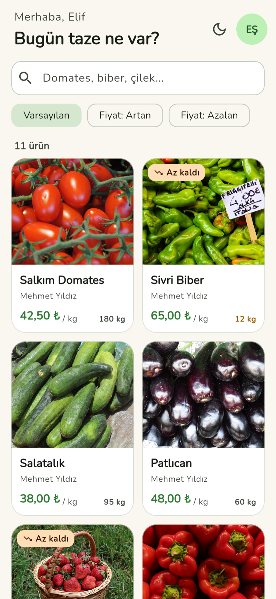
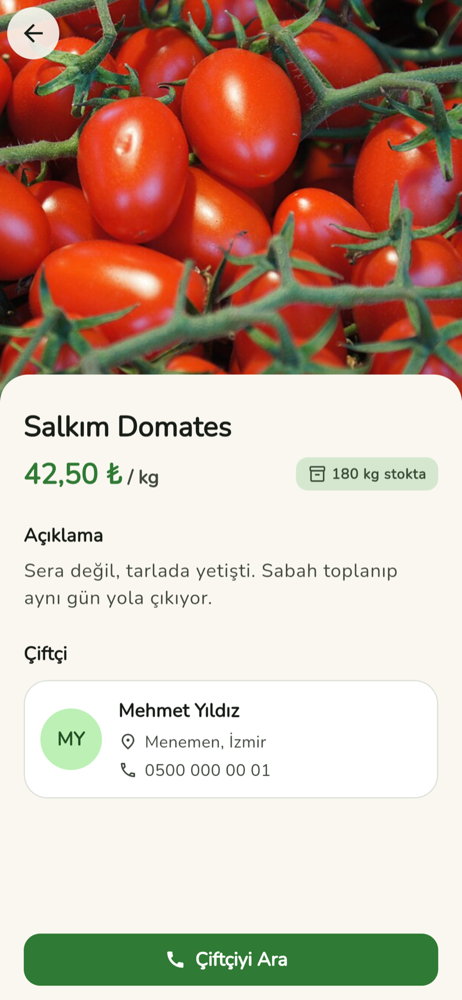
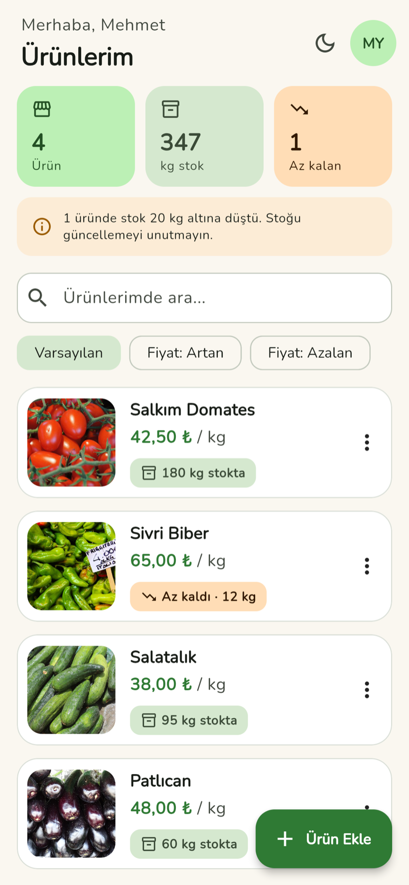
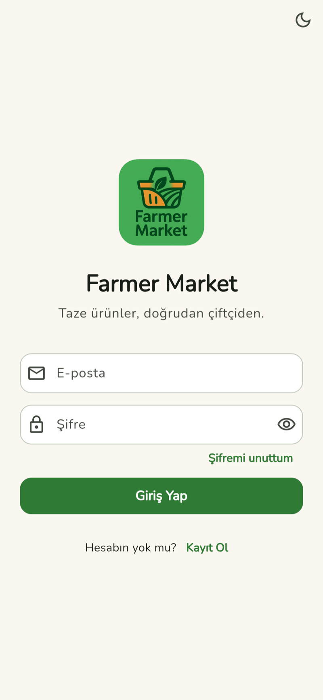
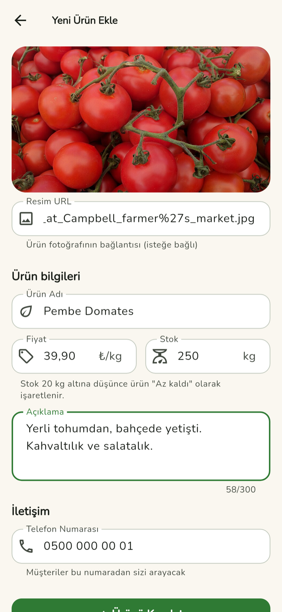

<p align="center">
  
</p>

A mobile marketplace where farmers sell their produce directly to customers.

Flutter · Firebase (Authentication, Firestore) · Provider

<p>
  
  
  
</p>

People sign up as a farmer or as a customer and see a different app for each. Customers browse the products in a grid, search them by name, sort them by price and open one to see its details, who grows it and where. The "Çiftçiyi Ara" button on that page starts a phone call to the farmer.

Farmers get a panel with only their own products, a short summary of their stock and a warning when a product drops below 20 kg. They add and edit products with a price per kilogram, stock in kilograms, a description, a phone number and a photo. Photos are not uploaded anywhere: the form takes an image URL, shows a preview, and the URL is saved with the product in Firestore.

<p>
  
  
</p>

The interface is in Turkish and has light and dark themes. Firestore rules in `farmer_market/firestore.rules` make sure only the farmer who added a product can change or delete it.

## Running it

You need [Flutter](https://docs.flutter.dev/get-started/install) 3.50 or newer.

```bash
git clone https://github.com/omeraydin00/farmer_market.git
cd farmer_market/farmer_market
flutter pub get
```

### With your own Firebase project

By default the app connects to the original Firebase project in `lib/firebase_options.dart` and `android/app/google-services.json`. To use your own, create a Firebase project, turn on Email/Password sign-in and Firestore, and run `flutterfire configure` inside `farmer_market/` to regenerate both files. Then deploy the rules with `firebase deploy --only firestore:rules` and start the app with `flutter run`.

### Locally with the emulator

This needs no Firebase account. Start the Auth and Firestore emulators under a demo project, load the sample data from a second terminal, and run the app with the `USE_EMULATOR` flag:

```bash
npx firebase-tools emulators:start --project demo-farmer-market
node tool/seed_emulator.mjs
flutter run -d chrome --dart-define=USE_EMULATOR=true
```

The seed script creates three farmers, two customers and eleven products. Every account uses the password `demo1234`; try `mehmet@ornek.com` for the farmer side and `elif@ornek.com` for the customer side. The emulators need Java 21 with the current firebase-tools; on Java 17, `npx firebase-tools@13` works. Firestore runs on port 8085 instead of the usual 8080. On an Android emulator, add `--dart-define=EMULATOR_HOST=10.0.2.2` so the app can reach your machine.

The sample product photos are from Wikimedia Commons; their file names are in the seed script.
