<p align="center">
  
</p>

A mobile marketplace where farmers sell their produce directly to customers.

Flutter · Firebase (Authentication, Firestore, Storage) · Provider


People sign up as a farmer or as a customer and see a different app for each. Farmers add their products with a price, stock in kilograms and a photo, and edit or remove them later. Customers search and sort the products by price, open a product to see its details and call the farmer straight from there. The app has light and dark themes, and everything is kept in sync through Firebase.

<p>
  
  
</p>
<p>
  
  
</p>

## Running it

You need [Flutter](https://docs.flutter.dev/get-started/install) 3.22 or newer and an Android emulator or device.

```bash
git clone https://github.com/omeraydin00/farmer_market.git
cd farmer_market/farmer_market
flutter pub get
flutter run
```

The app connects to the Firebase project in `android/app/google-services.json`. To use your own, create a Firebase project and replace that file.
